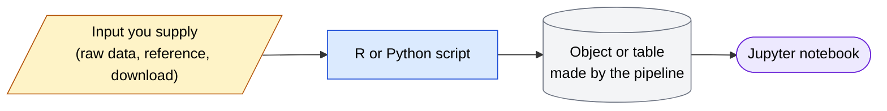
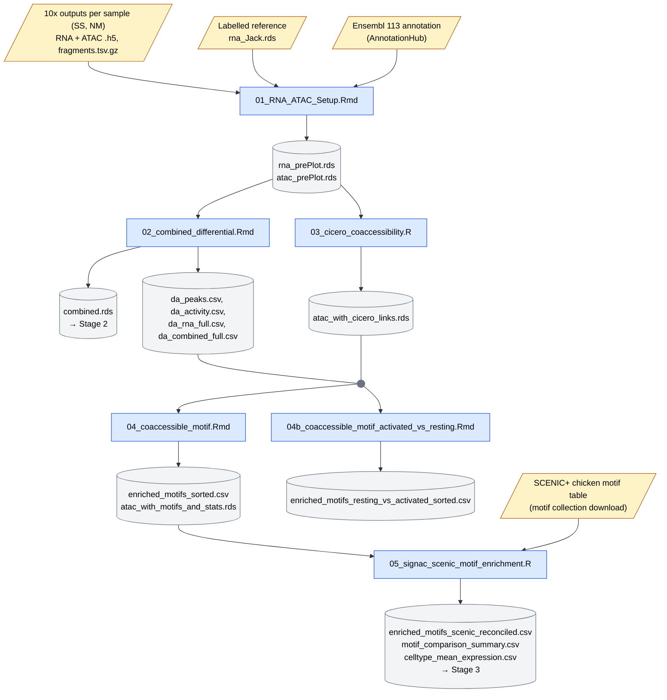
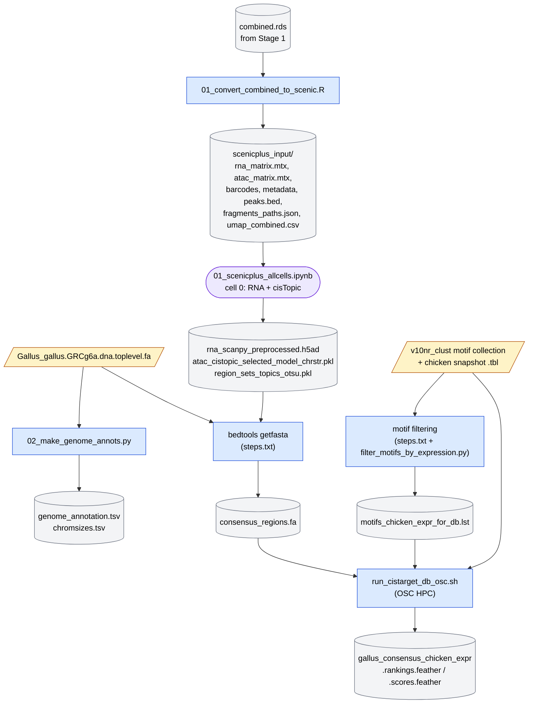
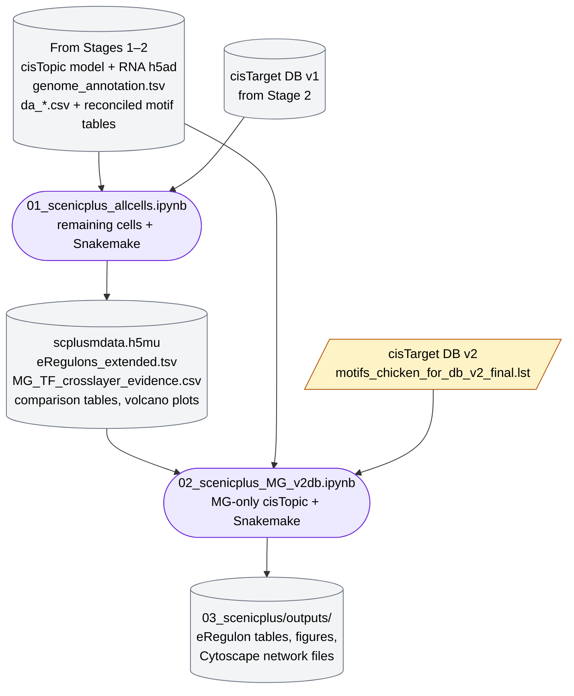
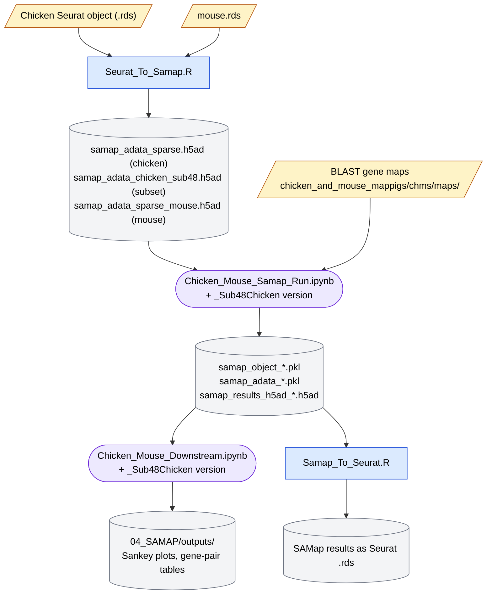

# Chicken Retina Multiome: Seurat + SCENIC+

Single-cell RNA + ATAC analysis of chicken (*Gallus gallus*) retina from two samples (SS, NM). The main question is what separates **activated** from **resting Müller glia (MG)**, first through differential expression, accessibility and motif enrichment in Seurat/Signac, then through gene regulatory networks (eRegulons) inferred with SCENIC+.

The project runs in three stages, plus a separate side analysis:

1. **Seurat / Signac** (R): build the RNA and ATAC objects, label cell types, run differential analysis and motif enrichment.
2. **SCENIC+ prep**: export the data for Python and build a chicken cisTarget motif database.
3. **SCENIC+** (Python): run the SCENIC+ Snakemake pipeline and analyse the eRegulons for MG.
4. **SAMap** (side analysis): map chicken retina cells onto a mouse dataset.

---

## Repository layout

```
.
├── README.md
├── 01_seurat/
│   ├── 01_RNA_ATAC_Setup.Rmd
│   ├── 02_combined_differential.Rmd
│   ├── 03_cicero_coaccessibility.R
│   ├── 04_coaccessible_motif.Rmd
│   ├── 04b_coaccessible_motif_activated_vs_resting.Rmd
│   ├── 05_signac_scenic_motif_enrichment.R
│   └── outputs/                      # knitted reports, interactive UMAPs, DA tables
├── 02_scenicplus_prep/
│   ├── 01_convert_combined_to_scenic.R
│   ├── 02_make_genome_annots.py
│   └── cistarget_db/
│       ├── steps.txt
│       └── run_cistarget_db_osc.sh
├── 03_scenicplus/
│   ├── 01_scenicplus_allcells.ipynb
│   ├── 02_scenicplus_MG_v2db.ipynb
│   ├── flow_chart_SCENIC+.png        # generic SCENIC+ workflow figure (SCENIC+ docs)
│   ├── scenicplus_environment.yml    # conda environment export
│   ├── scenicplus_pip_freeze.txt     # pip package versions
│   └── outputs/                      # eRegulon tables, figures, Cytoscape network files
└── 04_SAMAP/
    ├── Seurat_To_Samap.R
    ├── Chicken_Mouse_Samap_Run.ipynb
    ├── Chicken_Mouse_Samap_Run_Sub48Chicken.ipynb
    ├── Chicken_Mouse_Downstream.ipynb
    ├── Chicken_Mouse_Downstream_Sub48Chicken.ipynb
    ├── Samap_To_Seurat.R
    ├── requirements.txt              # Python package versions for SAMap
    ├── top_200_MGPC_DE_genes.csv     # top 200 DE genes for MG-derived progenitors (MGPCs)
    ├── chicken_and_mouse_mappigs/    # BLAST gene maps (chms/ and msch/)
    └── outputs/                      # Sankey plots, gene-pair tables, UMAPs, MGPC gene lists
```

Scripts in `01_seurat/` and `02_scenicplus_prep/` are numbered in run order. Large objects (`.rds`, `.h5ad`, `.h5mu`, cisTopic pickles, feather databases, raw 10x data) are not in the repo; `.gitignore` keeps them out.

---

## Reading the diagrams

Each stage has its own flowchart. The shapes show what each box is:



Arrows point from what a step reads to what it writes. A small grey dot is a junction: everything flowing into it is used by every step flowing out of it. To keep the charts readable, each one draws only the main files a step builds on; the tables under each chart list every file a step reads.

---

## Stage 1: Seurat / Signac (`01_seurat/`)



### Scripts

| File | What it does |
|---|---|
| `01_RNA_ATAC_Setup.Rmd` | Loads both samples, merges RNA, and transfers cell-type labels from the reference (`rna_Jack.rds`, which splits cell types into finer subsets than the earlier `NEW_clod_NMDA.rds` reference). Builds a shared ATAC peak set, runs QC (TSS enrichment, nucleosome signal, drops a low-quality cluster), and labels ATAC cells through gene activity. |
| `02_combined_differential.Rmd` | Imputes RNA into ATAC, merges both into one object with a joint UMAP, and runs activated vs resting MG tests: differential peaks, gene activity and RNA DE. |
| `03_cicero_coaccessibility.R` | Runs Cicero co-accessibility on the ATAC object (about 3 h) and makes early coverage plots. |
| `04_coaccessible_motif.Rmd` | Coverage + expression plots for the top and bottom DE genes with Cicero links, then JASPAR motif annotation, chromVAR, and GC-matched motif enrichment in activated-MG peaks. |
| `04b_coaccessible_motif_activated_vs_resting.Rmd` | Variant that tests activated peaks against resting peaks directly, and the reverse. |
| `05_signac_scenic_motif_enrichment.R` | Reruns the Signac motif enrichment using only TFs that also appear in the SCENIC+ chicken motif table, so the two approaches can be compared. Also exports mean expression per cell type. |

### Objects

| Object | Made by | Used by |
|---|---|---|
| `rna_prePlot.rds` | 01 | 02, 03, 04, 04b, 05 |
| `atac_prePlot.rds` | 01 | 02, 03, 04, 04b |
| `combined.rds` | 02 | Stage 2 export |
| `da_peaks.csv` | 02 | 04, 04b, 05 |
| `da_rna_full.csv`, `da_combined_full.csv` | 02 | Stage 3 notebooks |
| `atac_with_cicero_links.rds` | 03 | 04, 04b |
| `atac_with_motifs_and_stats.rds` | 04 | 05 |
| `enriched_motifs_sorted.csv` | 04 | 05 |
| `enriched_motifs_scenic_reconciled.csv`, `motif_comparison_summary.csv`, `celltype_mean_expression.csv` | 05 | Stage 3 notebooks |

### `01_seurat/outputs/`

| File | What it is |
|---|---|
| `RNA_ATAC_Setup.html` | Knitted report of `01_RNA_ATAC_Setup.Rmd` from an earlier run with the `NEW_clod_NMDA.rds` reference |
| `combined_differential.html`, `coaccessible_motif.html` | Knitted reports of scripts 02 and 04 |
| `RNA_CellType.html`, `ATAC_CellType.html`, `ATAC_Sample.html` | Interactive UMAPs from script 01 |
| `UMAP_Nucleosome_Signal_Merged_ATAC_PostQC.html`, `UMAP_nCountATAC_Merged_ATAC_PostQC.html` | Interactive ATAC QC UMAPs from script 01 |
| `Integrated_UMAP_*.html` | Interactive joint RNA + ATAC UMAPs from script 02 (by cell type, modality and sample); `Preliminary/` holds earlier versions |
| `da_peaks.csv`, `da_activity.csv` | Differential accessibility and gene activity, activated vs resting MG |

---

## Stage 2: SCENIC+ prep (`02_scenicplus_prep/`)

The motif database is built from the regions in the cisTopic model, so it depends on the first part of the all-cells notebook (cell 0: RNA preprocessing and cisTopic). The rest of that notebook runs in Stage 3, once the database exists.



| File | What it does |
|---|---|
| `01_convert_combined_to_scenic.R` | Exports `combined.rds` into `scenicplus_input/` as matrices, barcodes, metadata, `peaks.bed`, fragment paths and the UMAP. |
| `02_make_genome_annots.py` | Pulls the gene annotation from Ensembl BioMart and computes chromosome sizes from the GRCg6a FASTA. |
| `cistarget_db/steps.txt` | How the cisTarget database was built: filtering motifs to chicken, filtering by expression, building the consensus FASTA, the database command, and downloading the genome annotation for Snakemake. |
| `cistarget_db/run_cistarget_db_osc.sh` | SLURM job that builds the cisTarget motif database on OSC. |

---

## Stage 3: SCENIC+ (`03_scenicplus/`)



Both notebooks run the SCENIC+ Snakemake pipeline from inside the notebook.

| File | What it does |
|---|---|
| `01_scenicplus_allcells.ipynb` | SCENIC+ run on all cell types. Cell 0 does the scanpy RNA preprocessing and cisTopic topic modelling (Stage 2). The remaining cells check and repair the feather database and region names, run the Snakemake pipeline, and compare activated vs resting MG across RNA, ATAC and eRegulon layers. |
| `02_scenicplus_MG_v2db.ipynb` | **Final analysis.** Reruns cisTopic on MG cells only, builds per-cell-type region sets, and runs SCENIC+ against the rebuilt v2 database. Produces the Cytoscape network, simulated TF knockouts (MYC, RUNX1, THRB, ELF3) and the top eRegulon/target tables. |
| `scenicplus_environment.yml`, `scenicplus_pip_freeze.txt` | The conda environment and pip package versions used for the SCENIC+ runs. |
| `flow_chart_SCENIC+.png` | Generic SCENIC+ workflow figure from the SCENIC+ documentation, for reference. |

### `03_scenicplus/outputs/`

| Files | What they are |
|---|---|
| `TF_act_vs_rest.csv`, `TF_MG_vs_background.csv`, `TF_table_statistics.csv`, `MG_TF_crosslayer_evidence.csv`, `focal_TF_crosslayer.csv` | TF-level comparisons: activated vs resting MG, MG vs other cell types, and evidence combined across RNA, ATAC and eRegulon layers |
| `MG_eRegulon_AUC_delta.csv`, `TF_ΔAUC_bars.png`, `RSS_scores.csv`, `RSS_plot.png`, `MG_specificity_check.csv` | eRegulon activity (AUC) differences and cell-type specificity (RSS) |
| `top_eRegulons_RNA_ATAC.*`, `top_eRegulon_top5_targets.*` | Top eRegulons and their top target genes (table + plot) |
| `focal_TF_targets_ACT.csv`, `focal_TF_targets_REST.csv`, `MG_enriched_TF_targets.csv`, `MG_vs_bg_TF_targets.csv`, `target_gene_TF_links.csv` | TF → target gene lists |
| `genes_act_vs_rest.csv`, `gene_table_act_vs_rest.csv`, `transition_genes.csv`, `top_pathway_genes.csv`, `hub_genes.csv` | Gene-level tables for activated vs resting MG |
| `r2g_activated_MG_DE_genes.csv`, `r2g_resting_MG_DE_genes.csv` | Region-to-gene links for DE genes in each MG state |
| `volcano_act_vs_rest.png`, `volcano_TF_gene.png`, `volcano_EGF_family.png` | Volcano plots |
| `KO_predicted_effects.png` | Predicted effects of the simulated TF knockouts |
| `MG_network.graphml`, `scenic_network_hub.xgmml`, `cytoscape_hub_nodes.csv`, `cytoscape_hub_edges.csv`, `scenic.cys` | Network files; `scenic.cys` is a Cytoscape session |

---

## Side analysis: chicken–mouse SAMap (`04_SAMAP/`)

This maps chicken retina cells onto a mouse retina dataset with [SAMap](https://github.com/atarashansky/SAMap), which aligns species using BLAST gene homology instead of shared gene names. It is related to the main project but doesn't feed into, or depend on, the stages above. There are two parallel runs: one with the full chicken dataset and one with a smaller chicken subset (`Sub48Chicken`).



| File | What it does |
|---|---|
| `Seurat_To_Samap.R` | Converts a Seurat object to `.h5ad` with sceasy so SAMap can read it, storing the cluster identities in `active_ident`. Set up for the mouse object, and rerun with the chicken object (or subset) to make the chicken input. |
| `Chicken_Mouse_Samap_Run.ipynb` | Loads the chicken and mouse `.h5ad` files and the BLAST homology maps, runs SAMap, shows the joint UMAP, and saves the SAMap object, the combined AnnData and a results `.h5ad`. |
| `Chicken_Mouse_Samap_Run_Sub48Chicken.ipynb` | Same run using the chicken subset. |
| `Chicken_Mouse_Downstream.ipynb` | Loads the saved SAMap object and compares the species twice: chicken treatment against mouse cell types, then cell type against cell type. Each comparison gives mapping scores, Sankey and chord plots, and the gene pairs driving the alignment. |
| `Chicken_Mouse_Downstream_Sub48Chicken.ipynb` | Same analysis on the subset run. |
| `Samap_To_Seurat.R` | Loads the SAMap pickles through reticulate and converts the results `.h5ad` back into a Seurat object for further analysis in R. |
| `chicken_and_mouse_mappigs/` | BLAST gene maps between chicken and mouse (`ch_to_ms.txt`, `ms_to_ch.txt`), made with SAMap's `map_genes.sh`. The notebooks read them from `chicken_and_mouse/chms/maps/`. |
| `top_200_MGPC_DE_genes.csv` | Top 200 differentially expressed genes for MG-derived progenitor cells (MGPCs) |
| `requirements.txt` | Python package versions for the SAMap environment |

### `04_SAMAP/outputs/`

| Files | What they are |
|---|---|
| `treatmentgenepairs.csv`, `celltypegenepairs.csv`, `CHcelltype_vs_MStreatment_gene_pairs.csv` | Gene pairs driving the chicken–mouse alignment, by treatment and by cell type |
| `CelltypeVSTreatmentSankey.png` | Sankey plot of chicken cell types against mouse treatments |
| `Chicken_MGPC_To*_genes.txt`, `Mouse_MGPC_To*_genes.txt` | MGPC gene lists by time point (12–24 h, 48 h+) for each species |
| `ch_*.png`, `ms_*.png`, `chPCNA.png`, `msPCNA.png`, `msCXCL2.png`, `ch_MG_UMAP.pdf`, `ms_MG_UMAP.pdf` | UMAPs coloured by treatment, identity and selected genes (PCNA, F3, HBEGF, TGFB2, CXCL2) |
| `Downstream Library 1/` | Plots from the full-chicken downstream run |
| `Downstream sub48 chicken library/` | Plots and gene-pair tables from the subset run |
| `Downstream sub48 chicken changing resolution/` | Subset-run UMAPs at a different clustering resolution |

---

## Software

R: Seurat v5, Signac, SeuratWrappers, BSgenome.Ggallus.UCSC.galGal6, JASPAR2020, TFBSTools, monocle3, cicero, biomaRt, AnnotationHub.
Python (SCENIC+): see `03_scenicplus/scenicplus_environment.yml` and `scenicplus_pip_freeze.txt`. Main packages: scanpy, pycisTopic, pycistarget, scenicplus (Snakemake pipeline), mudata, pyranges.
cisTarget database: `create_cisTarget_databases` with Cluster-Buster and the v10nr_clust motif collection.
SAMap: see `04_SAMAP/requirements.txt`. Main packages: samap, sam-algorithm (Python 3.10), plus sceasy and reticulate in R for converting between Seurat and AnnData.
